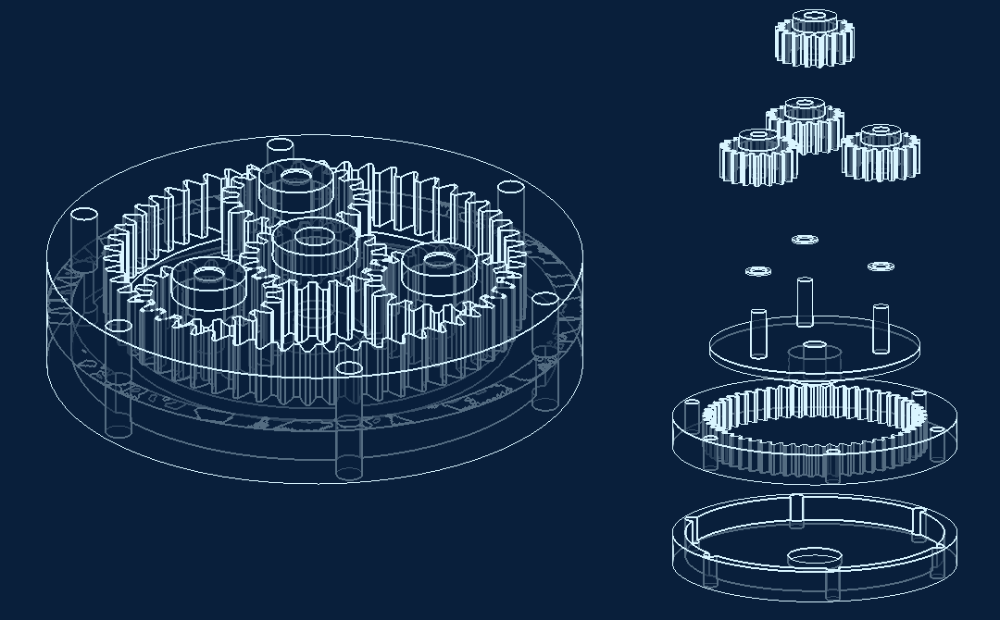

# Validation

Version 0.1.0 was exercised in isolated Unity projects on Windows 11 with Unity 6000.0.58f1, URP 17.0.4, Render Graph, Direct3D 11, and an NVIDIA GeForce RTX 2060 SUPER.

- **Occlusion regression.** An EditMode GPU test renders a small box completely behind a two-sided opaque wall. Two captured surfaces leave the central region blank. The third reveals the hidden box. An empty inclusion mask returns the region to paper.
- **Player.** A Windows x64 development player rendered 960 × 720 images of the assembled gearbox with one and four layers, the exploded assembly with four layers, and an empty mask. The empty mask produced one uniform color. The four-layer capture added internal lines, and the exploded capture separated the gears, washers, carrier, ring and case. The preview below uses camera readbacks from that player.
- **Package import.** A separate consumer project installed a local UPM archive and imported Planetary Gearbox through Package Manager. The scene opens with all ten mesh references and its scripts resolved.

The project's 6000.3.21f1 editor, other graphics APIs, XR, mobile devices, and frame-time budgets were outside this validation run.

