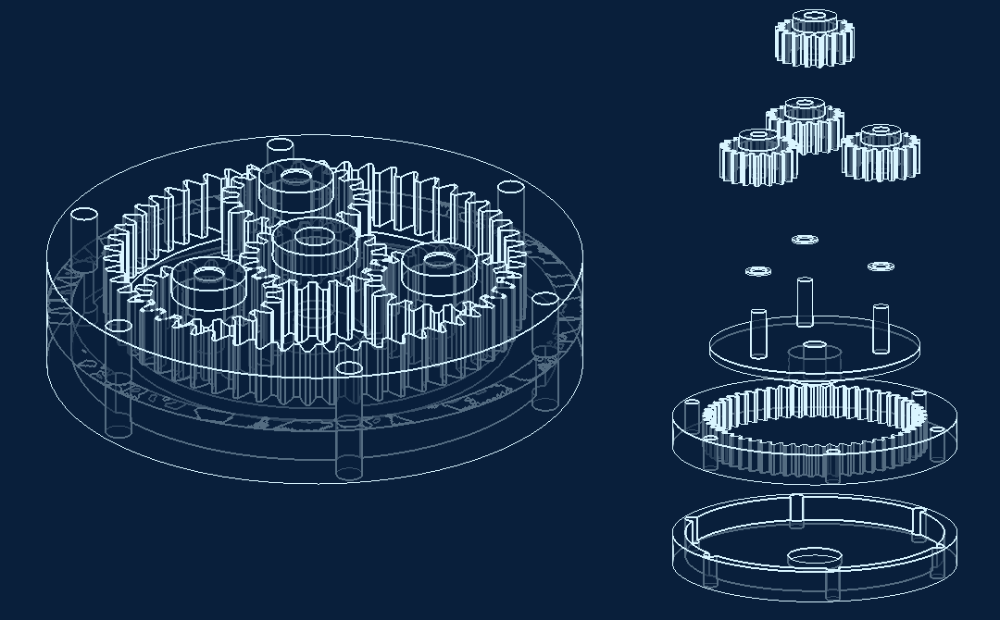

# Blueprint Rendering

Draw opaque mesh assemblies as technical blueprints at runtime. A base camera captures up to four surfaces per pixel and draws their silhouettes and creases in progressively lighter ink.



## Requirements

Unity 6 (6000.0 or later), URP 17, the Universal Renderer with Render Graph enabled, and a desktop graphics device with shader model 4.5 and floating-point render targets.

## Installation

In Package Manager, choose **Install package from disk** and select this package's `package.json`. For a remote revision containing the package, choose **Install package from git URL** and enter

```text
https://github.com/jlinkdev/unity-utilities.git?path=/Packages/com.jlinkdev.blueprint-rendering
```

## Quick start

1. Select the Universal Renderer Data asset used by your camera and choose **Add Renderer Feature → Blueprint Rendering**.
2. Add **Blueprint Camera** to a base camera. Select the GameObject layers that should appear on the drawing. Keep the geometry within the camera's culling mask.
3. Start with one surface layer to see the front contours. Increase to three or four to reveal internal geometry. Adjust **Hidden Ink**, **Crease Angle**, and **Line Width** on the camera. Disable the component to return to the ordinary camera image.

## Sample

Import **Planetary Gearbox** from Package Manager. Open `Planetary Gearbox.unity` and enter Play Mode. Drag to orbit, scrub **Explode**, and switch **Layers** between one and four. The demo temporarily selects its included URP asset in Play Mode and restores the previous selection on exit. [Sample guide](<Samples~/Planetary Gearbox/README.md>)

## Limitations

The blueprint covers the entire base camera image. Its layer mask selects the models and occluders in the drawing. The capture handles ordinary opaque triangle meshes with normals. Alpha cutouts, custom shader vertex deformation, transparent surfaces, XR, and the 2D Renderer are outside the supported scope. Keep baked occlusion culling off for a camera that must see fully occluded renderers.

## Documentation

[Rendering and tuning](Documentation~/rendering.md) · [Validation](Documentation~/validation.md) · [Changelog](CHANGELOG.md)

## License

Package code is MIT licensed. Innerscene released the sample gearbox under CC0. [Package license](LICENSE.md) · [Model source](https://www.innerscene.com/tools/library/3d-parts/three-planet-4-1-gearbox-open-assembly-2dfb48c4)
