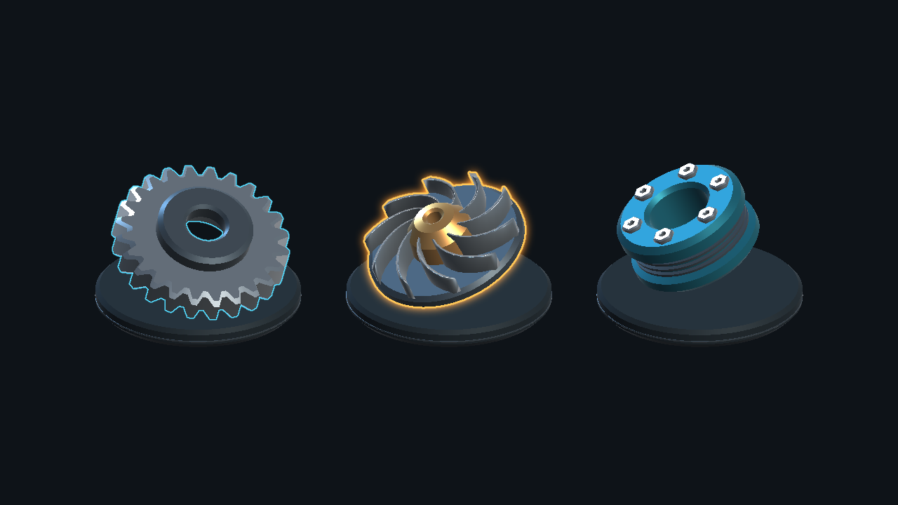

# Object Highlighting

Draw a crisp outline and a soft outer glow around individual 3D objects. Set hover and selection independently from gameplay code. Selection takes priority while both are active.



## Requirements

Unity 6.0 with URP 17.0.4 or later, the 3D Universal Renderer with Render Graph enabled, and a desktop graphics device. The sample uses Unity's IMGUI and Physics modules.

## Installation

In Package Manager, choose **Install package from disk** and select this package's `package.json`. To install a repository revision that contains the package, choose **Install package from git URL** and enter

```text
https://github.com/jlinkdev/unity-utilities.git?path=/Packages/com.jlinkdev.object-highlighting
```

## Quick start

1. On the Universal Renderer Data used by your base camera, choose **Add Renderer Feature → Object Highlighting**. The included cyan hover and amber selection styles work immediately.
2. Add **Rendering → Object Highlight** to the root of a mesh or multi-part prefab. Set **Initial State** to **Selected** to start highlighted on instantiation, or keep **None** for interaction-driven effects.
3. Have your picking or interaction system call `SetHovered(bool)` on pointer enter and exit, and `SetSelected(bool)` when selection changes. The same calls work for gamepad focus and scripted interactions.
4. For custom colors and widths, choose **Assets → Create → Rendering → Object Highlight Style** and assign the asset to the component or renderer feature. **Glow Resolution** on the feature sets the glow budget for that renderer.

```csharp
using jlinkdev.ObjectHighlighting;
using UnityEngine;

[RequireComponent(typeof(ObjectHighlight))]
public sealed class SelectablePart : MonoBehaviour
{
    private ObjectHighlight highlight;

    private void Awake() => highlight = GetComponent<ObjectHighlight>();

    public void OnFocusChanged(bool focused) => highlight.SetHovered(focused);
    public void OnSelectionChanged(bool selected) => highlight.SetSelected(selected);
}
```

## Sample

Import **Selection Gallery** from Package Manager. Choose **Install** for the shared Sample Framework captions or **Later** to keep the default captions. Open **Scenes/Selection Gallery.unity** and enter Play Mode. The gear starts with a cyan outline and the impeller with an amber outline and glow. Hover and click the three parts to change their states. The gallery camera runs the included highlighting feature. [Gallery guide](<Samples~/Selection Gallery/README.md>) · [Manual installation and version support](Documentation~/sample-framework.md)

## Limitations

The first release targets opaque, depth-writing MeshRenderers and SkinnedMeshRenderers on base cameras. Objects using the same style share an exterior contour where they touch. Transparent targets, shader-driven vertex displacement, XR, and the 2D Renderer are outside the supported scope. [Rendering details and supported configurations](Documentation~/manual.md)

## Documentation

[Styles, quality, API, and troubleshooting](Documentation~/manual.md) · [Validation](Documentation~/validation.md) · [Changelog](CHANGELOG.md)

## License

The package and its sample assets use the [MIT license](LICENSE.md).
