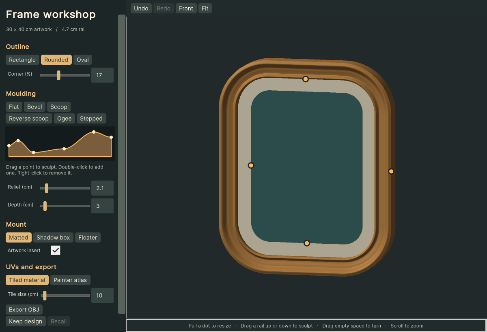

# jlinkdev Procedural Picture Frames

Pull a rail wider, lift a bead out of its face, and turn the frame to inspect the mitres. The runtime workshop, Scene view handles and standalone mesh builder share one editable design.



## Requirements

Unity 6000.0 or newer. The workshop uses runtime UI Toolkit and Unity JSON serialization. The generator produces ordinary Unity meshes. Preview materials ship with the package.

Verified in an isolated Unity 6000.0.58f1 project on Windows. The Edit Mode checks cover all five ornaments, both UV layouts, joins at the mitres and mesh export. Play Mode tests exercise the workshop’s on-frame controls.

## Installation

In this checkout the package is embedded. In another project, use **Package Manager → Add package from disk** and select this package’s `package.json`. For a remote revision containing the package, use the Git subfolder URL below.

```text
https://github.com/jlinkdev/unity-utilities.git?path=/Packages/com.jlinkdev.procedural-frames
```

## Quick start

1. Choose **GameObject → JLink → Picture Frame**. Select the object and pull the four gold Scene view handles. The left and bottom handles resize the visible artwork symmetrically, the right handle changes the rail width, and the top handle adjusts the mat or float gap.
2. In the Inspector expand **Recipe**. Choose an outline and mount. Use **Choose profile** for a starting moulding and open the **Profile** curve to sculpt its cross section. Assign Unity materials to the Mesh Renderer slots in moulding, mat, artwork order. **Easel back** adds a fourth slot for the tabletop support. [Front and rear views](Documentation~/tabletop-easel.png)
3. Choose **Edit profile loops in Scene view**. Click **+ Ridge** or **+ Groove**, point at the rail to preview the loop, and press to place it. Drag its body across the rail to move it. Pull either gold side dot to change width. Drag the blue top dot up or down to raise or cut the whole loop. The runtime workshop has the same controls under **Loops**.
4. With a loop selected, choose **Beads**, **Leaf scroll**, **Rope twist**, **Fluting** or **Egg-and-dart** under **Repeating detail**. Drag the green dot along the lower rail to size every repeat. Drag the coral dot to change the clear gap. Both measurements are also editable in millimetres.
5. Choose **Corners** in the workshop or **Edit linked corners in Scene view**. Choose one ornament and drag any corner handle in **Position**, **Size** or **Relief** mode to edit all four.
6. Choose **Edges** in the workshop or enable edge sculpting in the Inspector. On a rectangle, drag a corner, waist or centre. On an oval, drag the top, bottom or either linked side. Adjust **Reach** to widen the bend. Under **Loops**, set **Follow edge (%)** independently on each loop.
7. Choose **Tiled** for a repeating material or **Paintable** for a unique atlas. **Save mesh asset** bakes the current result. **Save design asset** keeps the editable recipe. **Export OBJ** writes the mesh and its material groups for DCC tools.

## Sample

In this checkout open `Assets/PackageDevelopment/ProceduralFrames/SampleAuthoring/Frame Workshop/Frame Workshop.unity`. In another project import **Frame Workshop** from the package’s **Samples** tab and open the imported scene. Press **Play** and choose **Loops**. The included **Ornament study** design opens with beads on the inner lip and a running leaf scroll on the outer rail. Select either loop to edit its repeats. Switch to **Frame** to reshape the base moulding or change the mount. [Workshop controls](<Samples~/Frame Workshop/README.md>)

## Limitations

Rectangular and oval rails support a sculpted silhouette around a fixed artwork opening. Mat and artwork faces represent display inserts. The floater includes a shelf and canvas sides. Enable **Easel back** for a tabletop frame with a backing board, hinge and deployed leg. Set **Lean angle** to 5–25°. Glazing and hanging hardware are outside this version. The workshop targets mouse input in a dedicated scene. Runtime OBJ export needs a writable filesystem.

## Documentation

[Subtle and dramatic oval scallops](Documentation~/oval-scallop-studies.png) · [Subtle and dramatic rectangular edges](Documentation~/rectangular-edge-studies.png) · [Workshop edge handles](Documentation~/rectangular-edge-controls.png) · [Linked corner variations](Documentation~/corner-variations.png) · [Corner mesh topology](Documentation~/corner-topology.png) · [Rope, fluting and egg-and-dart comparison](Documentation~/classical-ornaments.png) · [Ornament variations](Documentation~/ornament-variations.png) · [Workshop ornament controls](Documentation~/classical-controls.png) · [Scene view ornament handles](Documentation~/ornament-scene.png) · [Loop editing comparison](Documentation~/profile-loop-comparison.png) · [Runtime loop controls](Documentation~/profile-loop-controls.png) · [Geometry, material workflows, runtime API and design references](Documentation~/manual.md) · [Architecture review](Documentation~/architecture.md) · [Changelog](CHANGELOG.md)

## License

[MIT](LICENSE.md)
