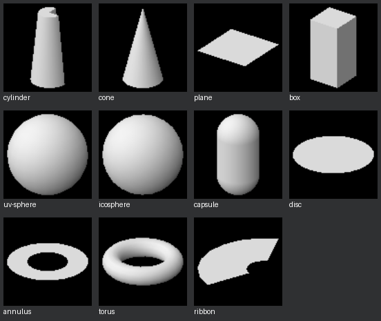

# Mesh generators

Choose **Generator** in a .procmesh Inspector and adjust its geometry. Output settings carry across generator changes. Apply updates references to the existing Mesh. Apply as Copy gives the draft its own asset identity.

The gallery shows the baked asset icons. The cylinder uses a capped partial sweep and the ribbon uses a 135-degree bend.

| Generator IDs | Geometry and mapping |
| --- | --- |
| `plane`, `box` | Control dimensions and segment counts per axis. Planes lie in XZ with +Y normals. Boxes split vertices at hard edges and give each face a planar UV island filling the unit square. |
| `cylinder`, `cone` | Independent end radii on cylinders also produce frustums. Cones use a zero-radius tip. Control radial sides, lengthwise segments, sweep, seam and planar end caps. Partial sweeps can close the two radial cut faces. Separate Ends places all closures in material slot 2. Normalized side UVs span the surface. World Units uses arc length at the larger radius for U and height for V. |
| `uv-sphere`, `icosphere` | Use latitude and longitude counts on the UV sphere, or recursively subdivide 20 triangular faces on the icosphere. Both provide spherical UVs. The icosphere splits UV discontinuities and unwraps triangles across the longitude seam. |
| `capsule` | Radius controls the hemispherical ends. Body Length measures only the straight section. Set it to zero to join the hemispheres directly. V follows meridian distance. |
| `disc`, `annulus` | Control radius, subdivisions, partial sweep and radial bands. Annulus adds an inner radius. Choose planar UVs or a strip with angular U and radial V. |
| `torus` | Major radius, tube radius, independent ring/tube segments, sweep and seam placement. U follows the major ring and V wraps the tube. |
| `ribbon` | A subdivided strip with width, centerline length and signed bend angle. Zero bend gives a straight ribbon. The inner edge must retain positive length. U spans the width and V follows the strip. |

## Shared output

UVs support scale, rotation about the UV origin and offset, in that order. Normalized height can be written to vertex color R before placement. Planar XZ geometry has constant height. The base pivot places the minimum local Y at the origin before orientation. Inside Facing reverses winding and normals and updates tangent handedness. Large surfaces automatically use 32-bit indices.

The default origin is the primitive's construction center. On a partial sweep it remains at the axis of revolution. The public `MeshGenerator.Generate` entry point applies the recipe's shared output controls. Keep the resulting Mesh as long as needed and destroy it when the runtime consumer releases it.
