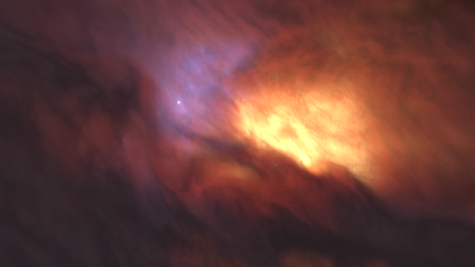

# Procedural Nebulae

A seeded, fly-through nebula with movable stellar lighting. In Starlit Passage, a folded bank of red dust crosses an amber emission cavity. A violet companion lights a smaller pocket on its flank.

## Requirements

Unity 6, URP 17 with Universal Renderer and Render Graph, desktop compute shaders, and 3D R16 and RGBA16 floating-point read/write textures. Use linear color space.

## Installation

Choose **Add package from disk** and select this folder's `package.json`. For a repository revision containing the package use **Add package from git URL** with `https://github.com/jlinkdev/unity-utilities.git?path=/Packages/com.jlinkdev.procedural-nebulae` and pin your revision.

## Quick start

1. Select your base camera or its Universal Renderer Data asset and run **Tools > jlinkdev > Procedural Nebulae > Configure Camera Renderer**. This adds or enables a feature on the selected renderer. The pass requests camera depth.
2. Choose **GameObject > Effects > Procedural Nebula**. Put the camera near the clearing and aim toward the child star. The sample uses a solid black camera background.
3. The **Starlit Banks** volume uses **Painterly Cavity**. Its profile defaults reproduce the authored amber cavity and violet pocket. Move either star or the clearing to adjust the composition.
4. To explore the other two main styles with their authored cameras and lighting, open **Tidal Veil** or **Ember Arc** from the sample. Duplicate a style profile into Assets and assign it to the volume to experiment with **Structure Warp**. Each of the six warps deforms the dust and gas together.
5. Reroll **Form seed** on the volume for a new arrangement or **Detail seed** for different erosion along the edges. **Reset** restores the profile default. Enable **Vary Star Positions** to vary the lights independently.

## Sample

Import **Starlit Passage** in Package Manager, open the included scene, configure its camera renderer, and press Play. [Sample guide](<Samples~/Starlit Passage/README.md>)

Open **Ember Arc** in a 3:2 Game view for a long coral and amber cloud bank curving beneath a cyan opening. A cooler fold turns back into the cavity behind the nearer right shoulder. The central star excites the diffuse gas and an off-axis amber companion grazes the left bank. On the style profile, **Transition Gas** colors the opening and **Outer Gas** and **Inner Gas** grade the warm crests. Press Play for the sideways camera move. [Unity capture](Documentation~/ember-arc.png)

The same sample includes **Backlit Bank Study**, a grayscale view with one white star behind the dust. A close lip overlaps the dark bank on the right. Across the opening, a second bank interrupts the light from a distant gas curtain. Use a square Game view for the authored framing, or move sideways in Scene view to see the layers slide past each other. [Unity capture](Documentation~/backlit-bank.png)

Open **Tidal Veil** for the color version of **Shoulder Surface Detail**. Both profiles use the same underlying sculpted banks and zero gas emission. Tidal Veil adds a lower foreground shelf and grades scattered starlight from violet through turquoise to silver. **Fold Relief** shapes smaller lips and shadow pockets along the banks. **Rear Crease** connects the shoulders of the bright rear cloud along one curved lip. Use **Foreground Shelf** to toggle the extra bank and **Transition Gas** alpha to blend the palette with **Lit Dust**. Press Play to see the layers move past one another. [Unity capture](Documentation~/tidal-veil.png)

Tidal Veil enables **Vary Bank Layout** on its style profile. Override **Form Seed** on the volume to move, turn, stretch and bend the foreground bank, rear bank and shelf independently. **Variation Strength** blends from the profile’s default composition to the selected seed. The shipped profile uses form seed **91** and detail seed **1049**. To reproduce an alternate seed from the earlier fixed-layout version, disable **Vary Bank Layout** on a copy of the profile.

Open **Shoulders and Pockets** and press Play for a 36-unit sideways camera move. This grayscale study uses one off-axis star, low wisps and zero gas emission. A separate 64³ single-channel texture adds and removes dust at the surface of two broad banks. The renderer bakes that displacement into the 128³ density grid before calculating the star’s shadows. Set the profile’s **Shape Displacement** to zero to compare the same camera and lighting with the unmodified banks. [Texture off and on](Documentation~/shoulders-and-pockets.jpg)

**Shoulder Surface Detail** repeats that camera move with fine folds along the displaced boundary. **Surface Detail** controls this layer independently of the larger shoulders. The camera and stellar shadow passes sample the same fine density. Higher settings increase integration steps to resolve smaller features. [Same-camera comparison](Documentation~/shoulder-surface-detail.jpg)

## Limitations

One enabled volume per camera layer mask, with a primary star and an optional companion. Both stars light the nebula. Opaque surfaces clip camera rays. Transparent objects render afterward. The field stays still and the star cache models cloud self-shadowing. Solid geometry does not cast into this cache. The package targets desktop base cameras and Scene view. XR and URP compatibility mode are outside v1.

## Documentation

[Rendering and authoring](Documentation~/manual.md) · [Validation and GPU timings](Documentation~/validation.md) · [Changelog](CHANGELOG.md)

## License

[MIT](LICENSE.md)
