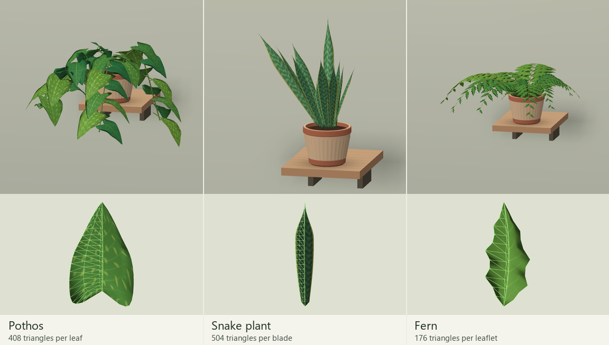
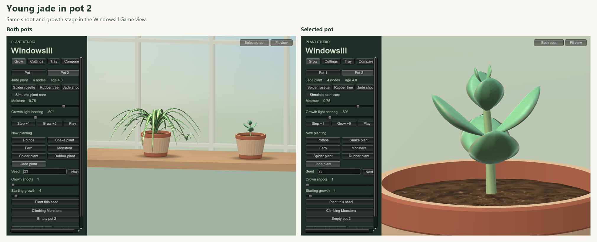
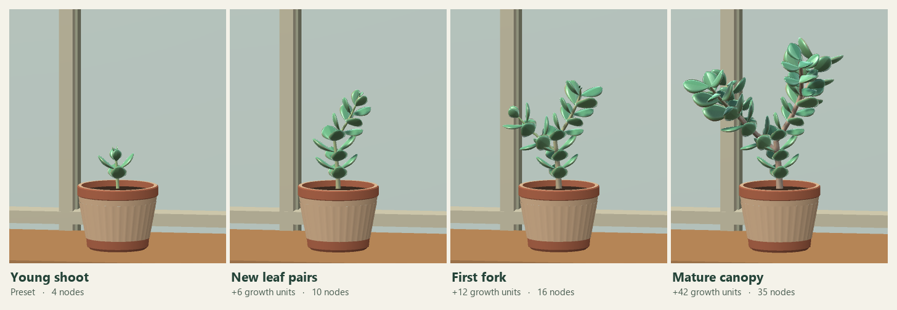
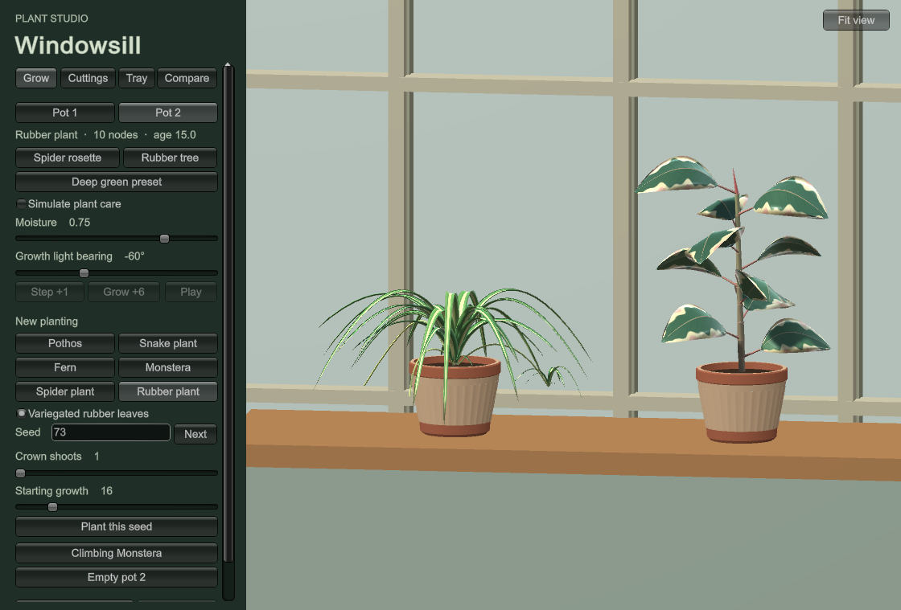
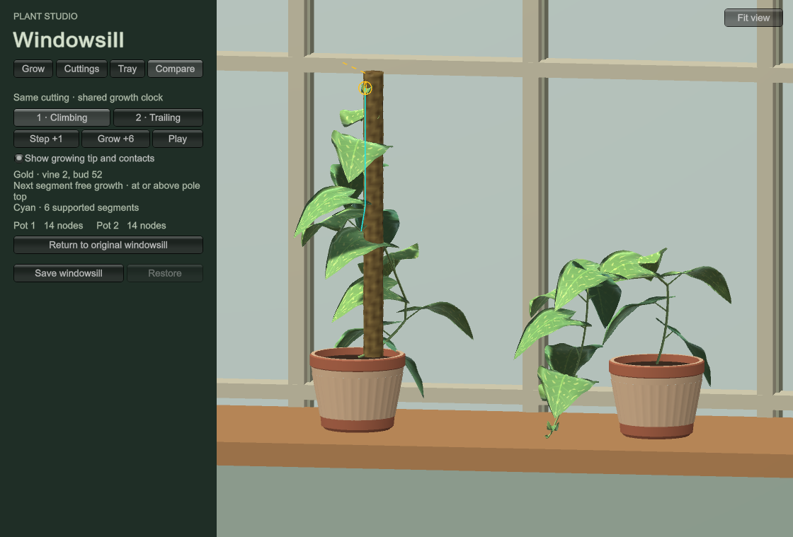
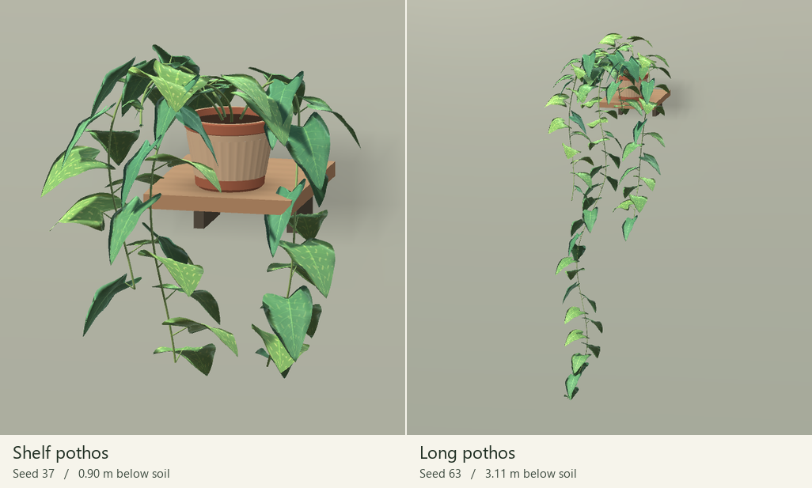

# jlinkdev Procedural Plants

Grow seven seeded houseplants in the editor or at runtime. Jade grows opposite pairs of fleshy leaves on branching stems. Spider plants send out detachable plantlets, and rubber plants grow glossy oval leaves. Pothos, snake plant, fern and Monstera round out the collection. Each specimen supports optional soil drying and watering, and can be baked as a living prefab or a static UV mesh.



## Requirements

Unity 6000.0 or newer. The package uses Unity's JSON serialization module and the sample uses IMGUI. **Botanical PBR** uses scene lighting in the Built-in pipeline or URP 17. **Botanical** supplies the original studio shading. Each plant exposes separate stem and foliage material slots.

## Installation

For this checkout, the package is already embedded. In another project use **Package Manager > Add package from disk** and select this package's `package.json`. The Git subfolder URL for a repository revision containing the package is:

```text
https://github.com/jlinkdev/unity-utilities.git?path=/Packages/com.jlinkdev.procedural-plants
```

## Quick start

1. Choose **GameObject > 3D Object > Procedural Plant**. Place the object's origin at soil level.
2. In **Next planting**, edit the recipe and starting growth, then choose **Generate from recipe**. Keep a seed to reproduce the same plant under the same conditions.
3. Change **Growing conditions** and choose **Advance 1 growth unit**. Older leaves finish opening and new organs take their heading from the current light.
4. Set **Surface** to **PBR** for textured, scene-lit foliage. Choose **Leaf Detail**, then **Save mesh with UVs…**. For the baked mesh, assign **Stem PBR** to the first renderer slot and **Leaf PBR** to the second.

## Sample

In **Windowsill**, choose **Selected pot** to inspect a new shoot or a freshly rooted plantlet. Switch pots to move the camera, or choose **Both pots** to see them together. The control appears in the Inspector in Edit mode and at the top right in Play mode.



Compare the foliage and daylight at the same growth stage across the two releases. [Jade](Documentation~/polish-jade.png) · [Variegated rubber](Documentation~/polish-rubber.png) · [Climbing and trailing pothos](Documentation~/polish-pothos.png)

Open **Windowsill → Grow → Jade shoot**. With default moisture, **Grow +6** takes the shoot from four paired-leaf nodes to ten. Press it again to see a side branch emerge below the growing tip. The same controls work in the Windowsill Inspector and in Play mode.



In **Windowsill**, choose **Grow → Spider rosette → Choose a plantlet → Detach and plant in pot 2**. Choose **Grow +6** to advance the daughter independently. **Rubber tree** offers deep-green and variegated presets. Enable **Simulate plant care** on either pot to try watering and reversible wilt. Care starts off.



Import **Windowsill** from Package Manager or open the authoring scene at `Assets/PackageDevelopment/ProceduralPlants/SampleAuthoring/Windowsill/Windowsill.unity`. Select **Windowsill · select for controls** to use the Inspector in Edit mode, or press **Play** for on-screen controls. **Grow** offers support placement and a climbing Monstera, **Cuttings** guides pruning and propagation into the second pot, and **Tray** compares six seeds with pinning, rerolling and baking. [Windowsill walkthrough](Samples~/Windowsill/README.md)

Choose **Compare → Start side-by-side → Grow +6** to advance two independent copies of the same eight-node pothos under identical light and moisture. A gold ring shows the next growing bud in the selected pot. Cyan traces its previously supported stems. Save the comparison to resume it later, or choose **Return to original windowsill** to restore the previous pots.



Import **Plant Studio** from Package Manager and open **Plant Studio.unity**. In this repository, open `Assets/PackageDevelopment/ProceduralPlants/SampleAuthoring/Plant Studio/Plant Studio.unity` directly. Press **Play**, switch species under **Planting**, then use **Growth** to move the light, step time, or save the specimen. Drag to orbit and scroll to zoom. [Sample controls](<Samples~/Plant Studio/README.md>)

Choose **Long pothos** for a mature trailing specimen. Toggle **PBR** above the viewport to compare materials on the same plant.



## Limitations

Growth uses bounded, species-specific rules and local-space light direction. Pothos and Monstera internodes respond to a plant-local circular rim, rectangular shelf and vertical pole. Arbitrary furniture meshes, leaf collisions and live vine physics are outside this model. UV0 repeats across individual organs. Projects using HDRP can assign compatible custom materials.

## Documentation

[Runtime API, growth model and mesh format](Documentation~/manual.md) · [Architecture review and shelf measurements](Documentation~/architecture-review.md) · [Validation record](Documentation~/validation.md) · [Changelog](CHANGELOG.md)

## License

MIT. [License notice](LICENSE.md)
