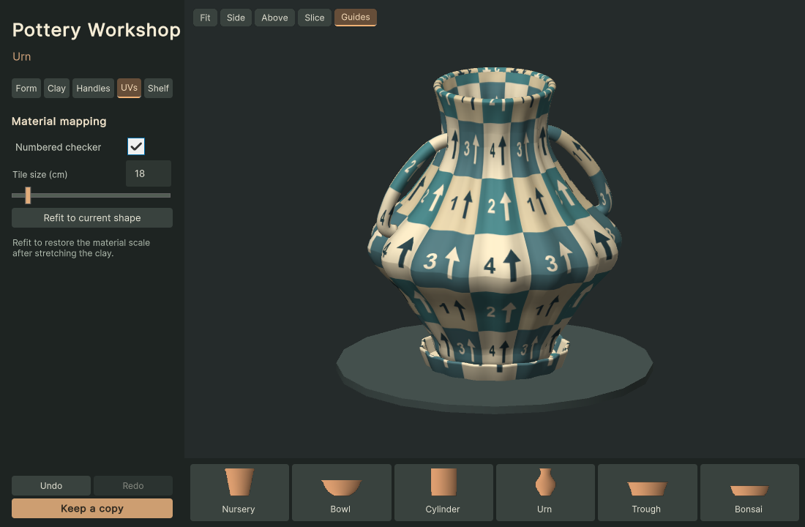

# Working with procedural pots

## Sculpting

In **Form**, press anywhere on the outside wall to pick a height on the pottery wheel. With guides enabled, the center line shows where pressure is strongest and the two lighter rings show its reach. Drag right to widen that band all the way around, or left to narrow it. **Band height (%)** sets the full vertical span as a percentage of the pot’s height. Try a wide band for a belly and a narrow band for a neck. A single undo restores the shape from before the drag.

The diamonds on the right outline follow the actual edge at the current camera angle. Drag a diamond sideways to widen that section and vertically to move a belly or neck. The bottom and mouth rings stay at the ends. Double-click the right outline between diamonds to insert a shaping ring. Select an intermediate ring to remove it. The grip above the mouth stretches the entire vessel. Type a dimension in millimetres and press Enter for an exact value. The width setting scales its body, measured before profile, footprint, lip and handle adjustments.

In **Clay**, pull the outer wall horizontally to add a smooth thumbprint or bulge. Brush size sets its angular and vertical reach. Strokes follow the body as it changes shape. This tab also controls the inner wall, floor, drainage, recessed foot, fluting and lip. Enable **Matching saucer** for a shallow dish fitted to the base footprint. Choose **Slice** to inspect the interior and floor. The slice affects the workshop preview only. Choose **Slice** again to resume direct sculpting. For a twisted flute, increase flute depth first and then adjust twist.

In **Handles**, choose a copy count or choose **Place on wall** and click the clay. The placement sets the height and angle of the first loop. Other loops repeat evenly around the body. Drag a loop diamond to adjust its reach and height. Gauge and span change its thickness and the distance between its roots.

Use a right drag to orbit from any tool. **Fit** frames the current pot. **Side** and **Above** change the angle. **Guides** hides the grips. Undo and redo cover preset changes, edits and shelf recalls. On desktop use Ctrl/Cmd+Z and Ctrl/Cmd+Shift+Z. Shelf copies persist across sessions for the application. Name a pot in **Shelf** before keeping a copy.

## Runtime API

The mesh builder accepts dimensions in Unity units, normally metres. Profile rings store normalized height and a radius multiplier against half the body's reference width. Keep the first ring at zero and the last at one. Normalize data loaded into a custom editor before querying the surface. Building normalizes the supplied recipe and writes into a caller-owned mesh. Reuse the builder and mesh during continuous editing.

```csharp
using JLink.Pots;
using UnityEngine;

public sealed class ExamplePlanter : MonoBehaviour
{
    void Start()
    {
        var vessel = gameObject.AddComponent<ProceduralPot>();
        var recipe = PotRecipe.Create(PotForm.Trough);
        recipe.width = .58f;
        recipe.fluteDepth = .06f;
        recipe.handles = 2;
        vessel.Apply(recipe);
    }
}
```

`ProceduralPot.Apply` takes a copy. To edit the component's live recipe, change `vessel.recipe` and call `vessel.Rebuild()`. The component owns its generated mesh. Use `new PotMesh().Build(recipe, destination)` when your game owns the mesh and renderer. The mesh has outward-facing exterior, interior, handle and saucer submeshes in that order. Supply one material per slot. Increasing `segments` raises circumferential resolution. Flutes and facets can increase the effective segment count to preserve their outlines.

`JsonUtility.ToJson(recipe)` serializes all geometry settings. Load a recipe with `JsonUtility.FromJson<PotRecipe>(json)`. Store the JSON in the game's save system. `PotDesign` is the Unity asset wrapper for the same data. The included clay shader uses fixed studio lighting for a consistent workshop view. Games can assign their own mesh materials.

## Materials and UVs

Assign a tiled Unity material to **Surface Material** on the workshop component before pressing Play, or drop materials into the Mesh Renderer slots of a Procedural Pot. For a Substance archive, import the `.sbsar` using Adobe's Unity plugin and assign the Unity material it produces. Standard Unity materials with exported PBR maps also work. Use Repeat wrap on tileable textures, material tiling of (1, 1), and unit object scale when judging centimetres. The generator has no Adobe runtime dependency. [Adobe Substance for Unity](https://experienceleague.adobe.com/en/docs/substance-3d/ecosystem/game-engines/unity/unity-plugin-overview)



**UVs** offers a numbered checker with arrows for checking orientation. You can sculpt with the checker visible and turn it off to return to the assigned material. Slice view previews the interior with the studio shader.

The first build stores the normalized shape as a mapping reference in the recipe. Tile size defaults to 10 cm. Changing tile size updates the density against that reference. Sculpting stretches the material with the vessel. **Refit to current shape** captures a fresh reference and participates in workshop undo. Older designs acquire a reference on first build. Reopen the design and bake again to add UVs to a pot previously exported without them. Shelf copies and saved designs carry the reference.

The exterior wraps horizontally by distance along each footprint and vertically by distance along the wall. The exterior strip continues over the lip. The inside wall has a separate strip. Each ribbon closes with a whole number of repeats, measured at its widest reference row, so a narrow neck compresses the pattern. Handle strips follow the arch with a seam inside the grip. Flat faces use planar charts, while the foot rim, saucer lip and drainage bore use strips. Generated meshes include UV0 and tangent frames for normal mapping.

### Painting one pot in Substance 3D Painter

1. Finish the shape. Under **UVs**, choose **Single texture set** for one painted material, or clear it for separate materials on the populated exterior, interior, handle and saucer slots.
2. **Export Painter OBJ** writes the final geometry with a packed UV0 atlas and a companion MTL file for the material names. Keep the two files together. Create a Painter project with the OBJ and bake mesh maps there as needed.
3. **Save paintable mesh** with the same shape and texture-set selection. Assign that asset to a Unity Mesh Filter, then apply the materials made from the painted maps. Each handle copy has its own space in the atlas. The atlas reserves four pixels of padding on every island edge at 1024 resolution.
4. **Save mesh** continues to bake the tiled layout. For a changed silhouette, export a fresh paintable OBJ and its matching Unity mesh together.

For procedural use, call `builder.Build(recipe, mesh)` for tiled UVs. Call `builder.Build(recipe, mesh, PotUvMode.Paintable, singleMaterial: true)` to pack UV0 for the current shape. `recipe.tileSize` is in metres. Call `recipe.RefitUVs()` and rebuild to accept the current surface as the new reference.

## Baking

**Save mesh** copies the current mesh into a standalone Unity asset. **Save design** copies the full recipe and its shaping rings into a Pot Design asset. Exports use unique paths to preserve earlier versions. Apply a baked mesh to a Mesh Filter on an ordinary GameObject. Apply a design to a Procedural Pot when you want to continue editing.
