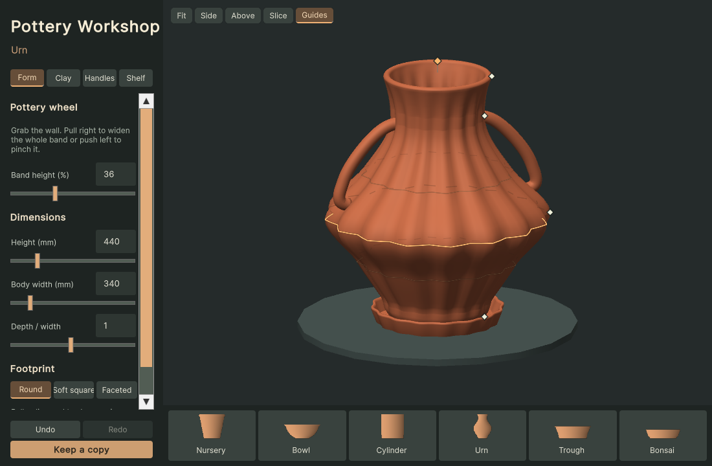

# jlinkdev Procedural Pots

Shape a vessel on a turntable, press a thumb into the clay and attach a set of loop handles. The same recipe drives the playable workshop, the Unity component and standalone mesh generation.



## Requirements

Unity 6000.0 or newer. The workshop uses runtime UI Toolkit, JSON serialization and Physics. The supplied clay material uses a studio-light shader. The generator works independently of a render pipeline.

Validated in an isolated Unity 6000.0.58f1 project on Windows with fourteen Edit Mode tests, five Play Mode tests, and a Windows Direct3D 11 player running the imported sample with the newer Input System.

## Installation

In this repository the package is embedded. In another project choose **Package Manager > Add package from disk** and select this folder’s `package.json`. The Git subfolder URL for revisions containing the package is:

```text
https://github.com/jlinkdev/unity-utilities.git?path=/Packages/com.jlinkdev.procedural-pots
```

## Quick start

1. In this repository, open `Assets/PackageDevelopment/ProceduralPots/SampleAuthoring/Pottery Workshop/Pottery Workshop.unity` and press **Play**. In a consuming project, import **Pottery Workshop** from the package’s **Samples** tab, then open the imported scene and press **Play**.
2. Choose **Urn** on the bottom shelf. In **Form**, grab the shoulder itself and drag right. The clay widens all the way around, carrying the handle roots with it. Drag left to pinch a neck. Drag empty space to orbit. Scroll to zoom.
3. In **Clay**, grab the outside wall and pull left to make a thumbprint. In **Handles**, pull a diamond on a loop to stretch the set.
4. Use **Keep a copy** to add a version to your runtime shelf. **Save design** creates an editable Unity asset. **Save mesh** bakes a mesh for a Mesh Filter. Both Unity assets survive leaving Play Mode.
5. To reopen a design, assign it to **Starting Design** on the workshop before pressing Play. A **Procedural Pot** component also accepts designs in its inspector.

For a tileable finish, assign a Unity material to **Surface Material** on the workshop. **UVs > Numbered checker** shows the mapping and **Tile size (cm)** sets its physical scale. Wheel and thumb strokes stretch the mapping with the clay. **Refit to current shape** measures it again.

For Substance 3D Painter, **UVs > Export Painter OBJ** writes a mesh with padded, unique UV islands. **Save paintable mesh** produces the matching Unity asset for the painted textures. [Material and export workflow](Documentation~/manual.md#materials-and-uvs)

## Sample

Import **Pottery Workshop** from the package’s Samples tab, open `Pottery Workshop.unity`, and press **Play**. The workshop creates its own camera and wheel in Play Mode. The controls are designed for a mouse. [Sample guide](<Samples~/Pottery Workshop/README.md>)

## Limitations

The wall is a stack of star-shaped cross sections. Each ring can have one radius in any given direction. The interior follows a radial inset, so thickness is approximate on steep or sharply dented walls. Loop handles intersect the body as separate closed shells. The tiled layout fits an integer number of repeats around each strip. Texture scale varies across a wide belly and a narrow neck. The shelf uses local PlayerPrefs and suits small personal collections.

## Documentation

[Generator and workshop manual](Documentation~/manual.md) · [Changelog](CHANGELOG.md)

## License

[MIT](LICENSE.md)
