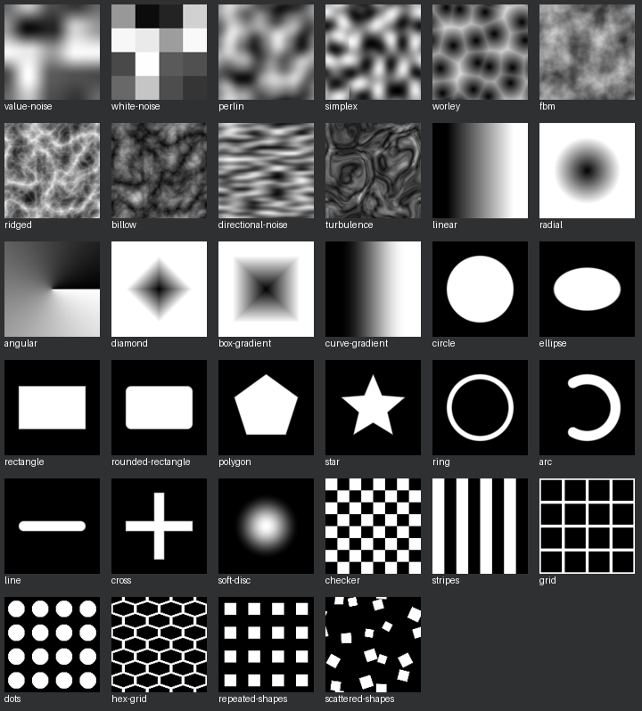

# Texture generators

Choose **Generator** to search by name or browse by family. **Apply** bakes the selection into the same Texture2D. During a single editing session the picker remembers the parameter values explored for each generator. Apply or Revert ends that session.

The gallery samples each field at 128 × 128. Noise and pattern examples use four cells per axis to make the underlying features visible.

| Family | Stable recipe IDs | Controls |
| --- | --- | --- |
| Noise | `white-noise`, `value-noise`, `perlin`, `simplex`, `worley`, `fbm`, `ridged`, `billow`, `directional-noise`, `turbulence` | Seed and cell counts determine the field independently of resolution. Fractal modes offer value, Perlin and simplex bases with octave, persistence and integer lacunarity controls. Directional noise stretches the field along the chosen axis. Turbulence warps the domain before summing unsigned noise. |
| Gradients | `linear`, `radial`, `angular`, `diamond`, `box-gradient`, `curve-gradient` | Rotate directional gradients and change their extent. The curve gradient evaluates an editable curve along its rotated axis. |
| Masks | `circle`, `ellipse`, `rectangle`, `rounded-rectangle`, `polygon`, `star`, `ring`, `arc`, `line`, `cross`, `soft-disc` | Size is a fraction of the shorter image side, so a circle stays round on rectangular output. Controls include softness, corner radius, point count, sweep or thickness where applicable. |
| Patterns | `checker`, `stripes`, `grid`, `dots`, `hex-grid`, `repeated-shapes`, `scattered-shapes` | Integer repeats define the composition. Checker repeats contain two squares per axis. A hex repeat contains two staggered rows. Repeated stamps offer circle, square and diamond shapes. Scattered stamps use seeded position, size and angular variation. |

## Shared processing

Open **Processing** on any generator. The recipe applies centered coordinate scale and rotation to offset UVs, adds the selected domain warp, evaluates the generator, blurs the scalar field, detects edges, then remaps the result and applies color. Blur and edge detection operate on scalar values clipped to the 0–1 range. Every stage starts neutral or disabled on existing assets.

| Control | Effect |
| --- | --- |
| Offset, coordinate scale and rotation | Scale multiplies sampling frequency per axis. Negative values mirror the field. Rotation works about the UV center. Generator-specific rotation still controls the underlying shape. |
| Domain warp | Displaces sample coordinates using smooth seeded noise. Choose both axes or a single direction. Warp frequency is the number of noise cells per UV axis. The warp seed is independent of the generator seed. Turbulence also retains its original internal warp. |
| Blur | **Isotropic** softens in both directions with a tent-shaped filter. **Directional** averages along a line. Zero degrees follows U and 90 degrees follows V. |
| Detect edges | A Sobel filter outputs the magnitude of local changes. **Edge width** controls the distance between samples. **Edge strength** controls the result before remapping. Constant regions become black. |

Warp displacement, blur radius and edge width are fractions of the shorter image side. A one-row or one-column strip uses its length. A radius of 0.05 spans about 13 texels from the center of a 256 × 256 texture. A reduced-resolution preview keeps the same relative footprint, subject to its available detail.

Warp respects the base generator's repeat axes. Filters wrap neighbours on periodic axes and clamp on open axes. A transformed axis repeats when one output tile traverses whole periods on repeating source axes and zero distance on open axes. Quarter turns can swap the repeat axes. Other rotations or fractional frequencies generally switch the affected output axis to clamp.

With blur or edge detection enabled, constructing a runtime `TextureField` evaluates the scalar grid at the recipe resolution. Subsequent `Sample(u, v)` calls interpolate that filtered grid before remapping. Reuse the field for multiple queries. A bake uses two float buffers during convolution, in addition to the output pixels.

## Output

The shared offset is in normalized UV units. A positive U offset moves features right. Output modes include grayscale, white RGB with the mask in alpha, and a multi-stop gradient. Click the **Gradient** swatch in **Color Ramp** mode. Add color keys below the ramp, opacity keys above it, and choose an interpolation mode in Unity’s gradient editor. Every generator can use the same color mapping. The selected levels, threshold or curve remap runs first, followed by inversion, contrast and brightness. The resulting scalar selects the gradient color. Conversion to RGBA32 is the final step.

For a horizontal shader lookup strip, choose **Linear** and **Color Ramp**, set the desired width and a height of **1**, and enable **Fit to texel endpoints**. With transition width **1**, zero rotation and offset, and neutral remapping, a 256-texel strip samples the ramp at `i / 255` for texel `i`. To address those samples with a normalized scalar `t` and bilinear filtering, use UV `((0.5 + t * 255) / 256, 0.5)`. A one-row preview is enlarged vertically for inspection.

On supported mask generators, **Encode signed distance** maps the shape boundary to 0.5. Values increase inside the shape. Distance range is measured as a fraction of the shorter image side and sets the distance from the boundary at which the encoding saturates.

Select independent seamless axes for noise and scattered stamps. Regular patterns tile at integer repeat counts. Preview repetition also lets you inspect a clamped asset across a join. White noise samples one independent value per cell. Set cell counts to the output dimensions for texel-sized noise within the supported range.

## Compatibility

The legacy value-noise hash and interpolation are retained. Increasing resolution samples the same field at additional pixel centers. For repeated CPU queries, construct a `TextureField` from the recipe and call `Sample(u, v)`; construct a new evaluator after editing the recipe.
