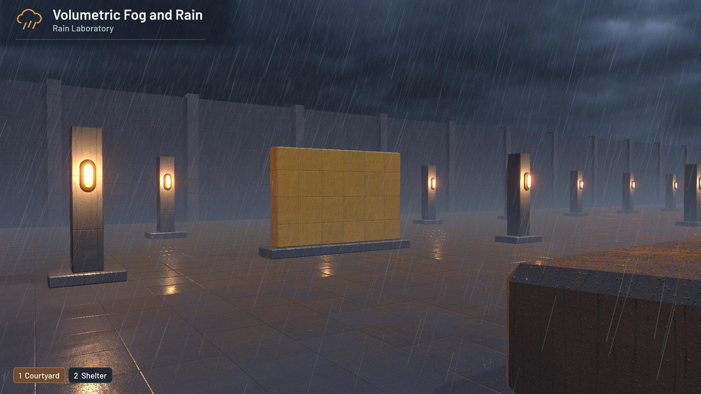
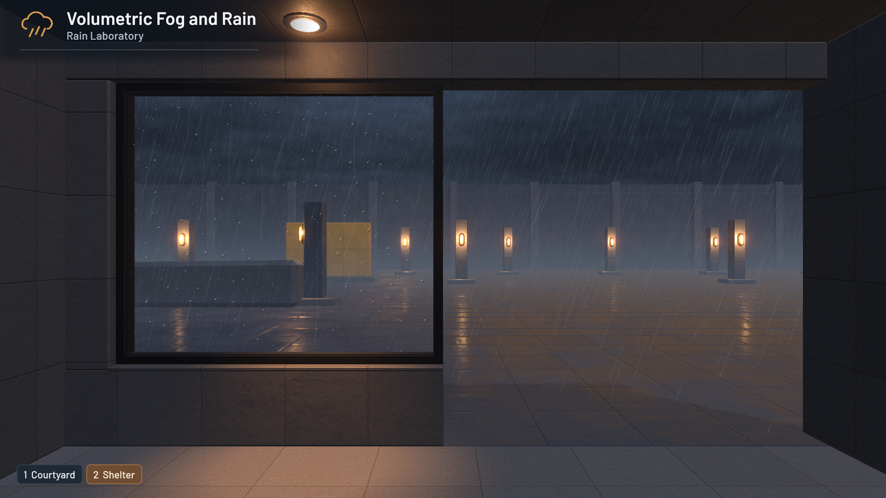

# jlinkdev Volumetric Fog and Rain

World-space rain, atmospheric fog, wet materials and interactive ground mist for Unity 6 URP.
The camera weather pass draws airborne rain and haze. Add a Fog Volume where characters,
gusts or obstacles should displace a persistent bank of mist.

Previously named Volumetric Rain. See [migration](Documentation~/migration.md)
for the new package ID, namespace, and Git URL.

## Requirements

- Unity 6 (`6000.0` or newer), desktop.
- URP `17.0.3` or a compatible newer version, using a **Universal Renderer**.
- Interactive ground mist uses compute shaders and writable floating-point textures. A scene allocates the fluid simulation when it enables a Fog Volume.
- **Render Graph enabled** (Compatibility Mode off). No VFX Graph dependency.

These are declared requirements, not a test matrix for every editor and platform.

## Installation

In **Window > Package Manager**, choose **Add package from git URL** and paste:

```text
https://github.com/jlinkdev/unity-utilities.git?path=/Packages/com.jlinkdev.volumetric-fog-and-rain
```

Append `#<tag-or-commit>` to pin a revision. For a local checkout, use **Add package
from disk** and select this package's `package.json`.

## Quick start

1. Select the renderer data asset used by your camera. Run **Tools > jlinkdev > Volumetric Fog and Rain > Add Feature to Selected Renderer** and save the asset.
2. Create a profile with **Assets > Create > jlinkdev > Volumetric Fog and Rain > Profile**.
3. Add **Volumetric Rain Camera** to a base Game camera and assign the profile.
4. Choose **Rain And Fog**, **Rain Only**, or **Fog Only** on the profile.
5. For a bounded effect, set **Extent > Volumes Only** and add a **Rain Volume** to an empty GameObject. Add **Rain Exclusion Volume** to carve out shelter.

The original component names also apply to fog. All boxes viewed by one camera
share its profile and mode. Assign **Scene View Profile** on the renderer feature
for an editor preview. The feature requests scene depth automatically.

For interactive mist, open **Tools > jlinkdev > Volumetric Fog and Rain > Interactive Fog Setup**, configure a camera renderer and create a Ground Mist, Cumulus or Dry Ice volume. Assign Fog Interactor to a moving object to leave a wake. When a camera renders both atmosphere and ground mist, enable **Share Atmosphere With Ground Fog** on its Volumetric Rain renderer feature so distant mist fades at its own depth. [Ground mist guide](Documentation~/InteractiveFog/GroundFog.md) · [Render timing and setup](Documentation~/rendering.md#interactive-ground-fog)

For ground mist, adjust **Fog Base Height**, **Fog Height Falloff**, and each box's
**Feather Distance**. Combined mode supports independent fog distances; fog noise
has its own velocity. Render timing and premultiplied output are renderer-feature
settings. See the linked guides for blending and transparent-output setup.

For rain on glass, assign a **Wet Glass** material and drive the pane with **Wet Rain Surface**. For collisions, place the **Rain Surface Impacts** prefab over a floor collider, or use its ring and spray with an existing particle emitter. [Wet windows and rain impacts](Documentation~/rain-surfaces.md)

## Sample

Import a laboratory from the package's **Samples** tab, open its matching scene
alone, and press Play:

| Sample | Demonstrates |
| --- | --- |
| [Rain Laboratory](<Samples~/Rain Laboratory/README.md>) | Switch between the open courtyard and its observation shelter. See wind-driven rain, stone beads, runoff and ground impacts outdoors, then compare wet-glass refraction with the clear view through the open bay. |
| [Fog Laboratory](<Samples~/Fog Laboratory/README.md>) | A dawn courtyard combining distance haze and a shallow simulated mist layer around solid walls. |
| [Mist Sanctuary](<Samples~/Mist Sanctuary/README.md>) | Character-driven wakes, obstacles, gusts and three interactive fog styles. |

The samples use camera-local rendering and keep the host project's renderer settings intact.





## Limitations

- Prototype; performance depends on resolution, range, grid spacing, and budgets.
- Up to **4 visible inclusion boxes and 8 exclusions per camera**; see volume limits.
- Opaque/depth-writing geometry occludes the effect; ordinary transparent surfaces do not.
- No XR, Built-in/HDRP, or Compatibility Mode support. Mobile is outside the validated scope.
- The atmosphere supports main-directional-light scattering and can share its transmission with Interactive Fog. Local lamps light opaque surfaces and their water film.
- The ground-mist solver operates in bounded spaces. Grid size controls memory use and the smallest obstacle or wake it can resolve. [Simulation costs and style profiles](Documentation~/InteractiveFog/Performance-and-Styles.md)
- Streak filtering has no temporal history or motion vectors; fast rain can alias.

## Documentation

[Render timing and transparency](Documentation~/rendering.md) |
[Runtime settings and blending](Documentation~/runtime-settings.md) |
[Migration](Documentation~/migration.md) |
[Controls and setup](Documentation~/manual.md) · [Volumes](Documentation~/volumes.md) ·
[Fog](Documentation~/fog.md) · [Algorithm](Documentation~/algorithm.md) ·
[Performance](Documentation~/performance.md) · [Evaluation](Documentation~/evaluation.md) ·
[Tested versions and validation](Documentation~/validation.md) · [Changelog](CHANGELOG.md)

## License

MIT. See [LICENSE.md](LICENSE.md).
