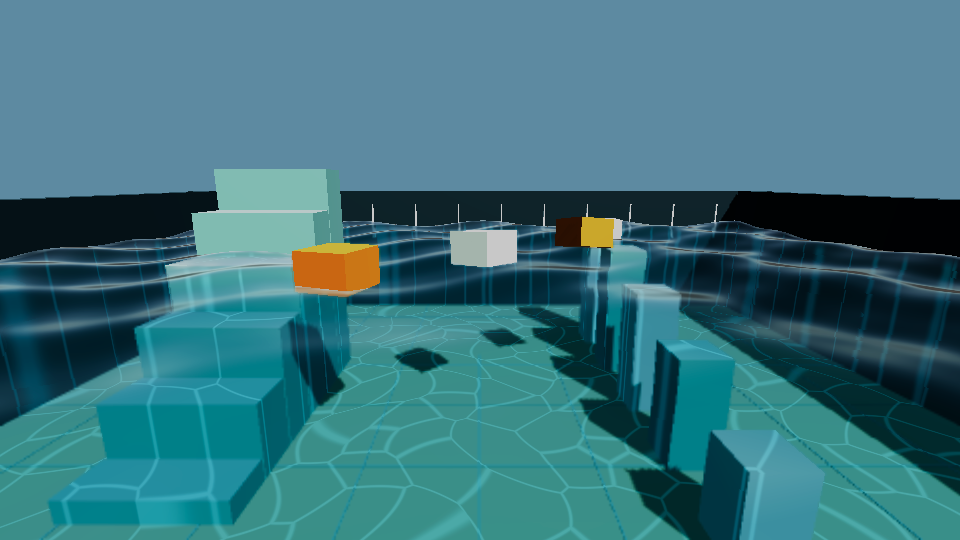
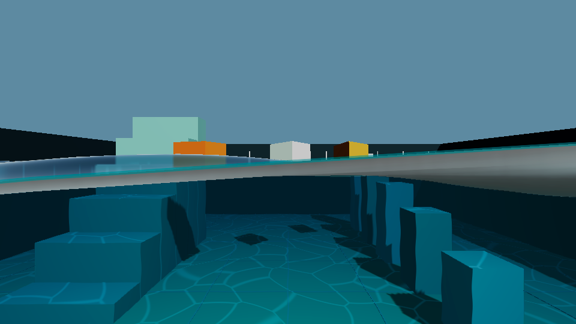
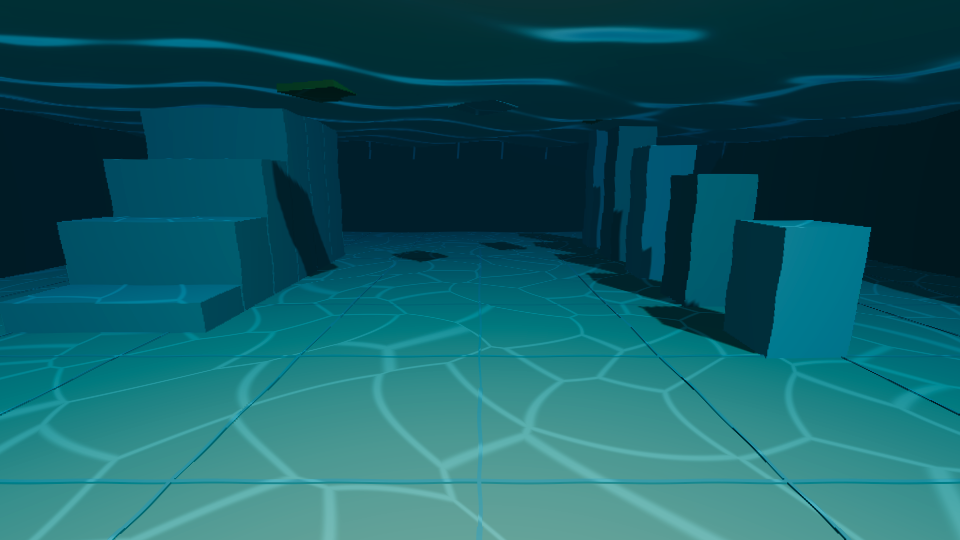

# Validation record

Version `0.1.0` is a local initial implementation, not a published release. The
checks below establish a working package, sample, and Windows player on one
configuration. They do not establish compatibility or performance on every
declared platform or editor version.

## Tested configuration

| Setting | Observed value |
| --- | --- |
| Editor | Unity `6000.0.58f1` |
| Render pipeline | URP `17.0.4`, Render Graph, forward Universal Renderer |
| Operating system | Windows 11, build `10.0.26200`, 64-bit |
| Graphics | Direct3D 11, NVIDIA GeForce RTX 2060 SUPER |
| Color and samples | Gamma color space; MSAA disabled (`1` sample) |
| Player | Windows x64 Development build, Mono backend |
| Automated test framework | Unity Test Framework `1.5.1` |
| Water scope | One finite, horizontal body and one base camera |

The package declares Unity `6000.0` and URP `17.0.3`. The validation project's
`17.0.3` request resolved to `17.0.4`; exact `17.0.3` was **not** tested. Linear
color space, newer editor/pipeline versions, other graphics APIs, IL2CPP, and
other operating systems remain unverified.

## Results

| Check | Result and scope |
| --- | --- |
| Package structure | PASS: repository validator checked 8 packages and 10 registered samples; `git diff --check` passed |
| EditMode tests | PASS: 24 tests covering wave sampling, grid topology, finite bounds, resource ownership, interaction events, camera state, and shader resource packaging |
| PlayMode tests | PASS: 8 tests covering buoyancy, mass independence, finite-volume behavior, runtime lifecycle, and particle ownership |
| Editor render smoke | PASS: dry, submerged, curved split, orthographic, rolled, outside-footprint, and below-bottom masks |
| CPU/GPU mask agreement | PASS: 0 mismatches across 13,551 compared pixels in the curved split case |
| Surface depth and self-occlusion | PASS: absorption/color control produced a mean RGB change of 0.2909; reversing triangle submission order at grazing incidence produced zero pixel difference |
| Standalone build and run | PASS: Windows x64 Development Mono player built and executed |
| Player physics smoke | PASS: three floating props remained valid through at least three seconds of both real time and simulated time |
| Player shaders and logs | PASS: all four water shaders supported; zero reported runtime errors |
| Player mask agreement | PASS: 0 mismatches across 13,551 compared pixels |
| Clean package consumer | PASS: candidate tarball installed into a separate project and Water Laboratory imported through the Package Manager sample API; 220 components and 97 dependencies checked |

The clean consumer check found no missing scripts, required references, shaders,
profiles, or pipeline assets, and no dependency on host `Assets/PackageDevelopment`
content. It also verified the renderer feature, post-processing resources, and
the sample's ACES Volume. That is an import/reference check; it does not repeat
the full player run in the consumer project. A final archive import is a separate
handoff check and must be rerun whenever the packaged artifact changes.

Mask comparisons sample the camera near plane against CPU surface queries. The
test excludes points within 3 mm of the boundary to avoid treating intended
coverage antialiasing as a geometric mismatch. Diagnostic masks are captured at
320 × 180; presentation views below are 960 × 540. Waves are frozen during these
repeatable numerical captures; the player warm-up exercises animated buoyancy.

## Captured sample views

The laboratory uses Calm water, opaque receiving geometry, and ACES tonemapping.
These captures document the checked configuration; they are not a benchmark.

Above water:

Camera intersecting the displaced surface:

Underwater:

## Reproduce from the source repository

Use a disposable project so validation does not interrupt another open editor or
change a working project's scene and pipeline. Host helpers are intentionally
outside the distributable package; the paths here are repository paths.

1. Install this package and URP, enable Render Graph, and add the package name to
   the manifest's `testables` array. Use Unity Test Framework `1.5.1` for the
   recorded configuration. Run EditMode and PlayMode tests through Unity Test
   Runner or `-runTests -testPlatform EditMode` / `PlayMode` with `-testResults`.
2. Copy the source authoring folder
   `Assets/PackageDevelopment/WaterSystem/SampleAuthoring/Water Laboratory` and
   `Assets/PackageDevelopment/Editor/WaterSystemDevelopmentBuilder.cs` into the
   isolated project. Run
   `jlinkdev.UnityUtilities.WaterSystem.Development.WaterSystemDevelopmentBuilder.BuildAll`.
   The builder opens a new scene and publishes its generated sample into the
   installed package, so use a writable local package for authoring.
3. Copy `Assets/PackageDevelopment/Editor/WaterSystemValidation.cs`. Invoke
   `jlinkdev.UnityUtilities.WaterSystem.Development.WaterSystemValidation.RenderSmoke`
   with Direct3D 11. This asynchronous method exits Unity after capture; omit
   `-quit`. It writes `WaterValidationCaptures/results.txt` and PNGs.
4. Copy `Assets/PackageDevelopment/WaterSystem/Validation/WaterPlayerSmoke.cs`
   and ensure the Image Conversion module is present for PNG capture. Invoke
   `WaterSystemValidation.BuildPlayer` in the same namespace. This host helper
   configures the isolated project's sample pipeline for its player build. Run
   `Builds/WaterLaboratory.exe -water-smoke -water-output <absolute-output-directory>`
   to execute the opt-in player checks and produce their report/captures.
5. For archive consumption, create another clean project, install the `.tgz`,
   and copy only
   `Assets/PackageDevelopment/Editor/WaterPackageImportValidation.cs` into its
   `Assets/Editor`. Invoke `WaterPackageImportValidation.ImportSample`, allow the
   imported scripts to compile, then invoke `VerifyImportedSample` in a separate
   editor invocation. Both methods use the development namespace above. Reports
   are `WaterImportedSamplePath.txt` and `WaterPackageImportValidation.txt`.

## Remaining validation

- Exact minimum URP `17.0.3`, Linear color space, other versions, graphics APIs,
  operating systems, and player backends have not been checked.
- GPU frame time, memory budgets, allocation profiles, long-duration stability,
  and large-scene behavior have not been measured.
- The evidence does not claim every sample button or preset was manually clicked,
  or that all combinations of scene unloading, additive scenes, and project
  settings were exercised. Complete that interaction review before release.
- The surface writes depth for wave self-occlusion. Transparent content behind
  the interface requires project-specific integration and separate validation;
  the packaged scene's refraction/depth receivers are opaque.
- XR, overlay-camera composition, multiple simultaneously composited water
  volumes, and external water shaders are outside this version's supported scope.

Before publishing, validate the final archive, manually review sample controls
and preset transitions, check slow animated crossings and opaque occlusion in
the intended game, and measure the target hardware. Keep these results separate
from the automated correctness checks above.
